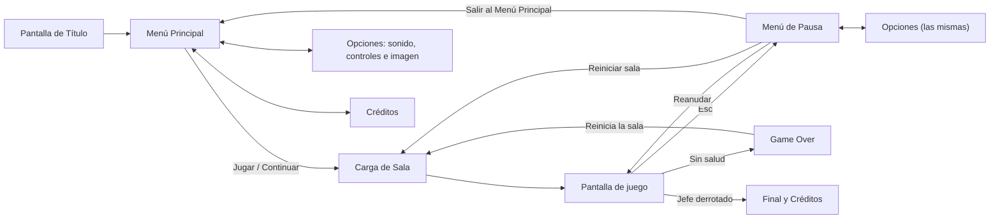

# Chrono-Shift: Ruin Core — GDD

**Versión del documento:** 1.2  
**Documento base de diseño del juego (GDD).**

**Alcance:** transcripción del GDD original para consulta en Codex; describe objetivos de diseño, no funcionalidades verificadas en el proyecto Godot. Se conservan las cifras y propuestas del documento.

Plantilla de GDD por Alberto Blanco, Cosmic Works Studios.

## Introducción

### Descripción breve del concepto

*Chrono-Shift: Ruin Core* es un micro-metroidvania 2D (un juego de plataformas y exploración, corto y compacto) de estética **Chronopunk** (relojería industrial del futuro: engranajes, vapor y luces de neón), hecho con el motor Godot. Su mecánica principal es la **Visión Desfasada**, que permite al jugador cambiar al instante entre dos versiones de una misma sala: el **Presente** (ruinas, plataformas rotas y trampas de energía) y el **Pasado** (instalaciones intactas, con estructuras sólidas pero con sistemas de seguridad activos). Cambiar de una a otra es la clave para abrir los caminos bloqueados.

### Descripción breve de la historia y personajes

En las profundidades de la *Torre Zaman*, un complejo de investigación energética, el Reactor Principal ha colapsado y roto el tejido del tiempo. Esto dejó a las instalaciones atrapadas en un bucle dimensional entre su **Pasado** (donde la estructura sigue intacta pero los sistemas de seguridad automatizados están activos) y su **Presente** (un escenario en ruinas, abismos y trampas energéticas).

### Personajes

**C.O.R.E.-9 (Protagonista):** Un autómata de mantenimiento de chasis ligero, cínico y agotado, que se reactiva tras la explosión. Equipado con una espada corta de energía y el *Módulo de Lente Temporal*, es el único sistema capaz de alternar entre las dos líneas temporales para reparar la torre.

**El Guardián del Núcleo (Jefe Final):** El androide principal de seguridad de la instalación. Corrompido por la falla temporal, interpreta el intento de reparación de C.O.R.E.-9 como una intrusión hostil.

Los enemigos del Pasado son sistemas de seguridad automatizados; los del Presente son anomalías del tiempo que buscan consumir la torre.

### Propósito, público objetivo y plataformas

**Propósito del Juego:** Más allá de entretener, *Chrono-Shift: Ruin Core* busca ejercitar el **razonamiento espacial y la memoria**. Con la *Visión Desfasada*, el jugador debe observar el entorno, recordar cómo se ve una dimensión (con ayuda del *Ghosting Temporal*, la silueta transparente de la otra dimensión) e imaginar cómo aprovecharla en la otra. Esto fomenta el análisis y la resolución rápida de problemas bajo presión.

**Comportamientos y transferencia de habilidades (Behaviors):** cada mecánica del juego se relaciona con una habilidad mental concreta y con una forma sencilla de comprobarla:

| **Mecánica**                                                           | **Habilidad que ejercita**      | **Qué hace el jugador**                                                       | **Cómo se comprueba**                                                                                 |
|------------------------------------------------------------------------|---------------------------------|-------------------------------------------------------------------------------|-------------------------------------------------------------------------------------------------------|
| Visión Desfasada + Ghosting Temporal                                   | Memoria y razonamiento espacial | Recordar la silueta de la otra dimensión y calcular el salto antes de cambiar | En las pruebas con jugadores se observa cuántas veces cambia de dimensión y cuánto tarda en cada sala |
| Salto de altura fija                                                   | Planificación                   | Calcular distancias y anticipar dónde va a caer antes de saltar               | Se observa si el jugador cae menos veces en los abismos con cada intento                              |
| Sala 4 y jefe final (escudos en el Pasado, punto débil en el Presente) | Toma de decisiones bajo presión | Elegir la dimensión correcta según el peligro del momento                     | Se observa cuántos intentos necesita para superar la sala 4 y al jefe                                 |

**Hipótesis de validación:** en las pruebas con jugadores se espera que, entre el primer y el tercer intento, el jugador tarde menos y caiga menos veces, lo que muestra que está aprendiendo a razonar sobre el espacio.

**Perfil del Jugador:** Dirigido a jóvenes y adultos que ya han jugado juegos de plataformas y disfrutan de retos que exigen reflejos y precisión (jugadores **mid-core**). Según los modelos de motivación de **Bartle y Marczewski**, el juego atrae a dos perfiles principales:

- **Exploradores (Free Spirits):** Motivados por descubrir y recorrer el mundo; usan el cambio de dimensión para encontrar caminos bloqueados.

- **Triunfadores (Achievers):** Motivados por superarse a sí mismos; buscan dominar los saltos de precisión y derrotar a los sistemas de seguridad.

**Plataforma Principal:** **PC (Windows)**, mediante un programa ejecutable (.exe) creado con Godot y publicado en **Itch.io**.

## Monetización

### Tipo de modelo de monetización

Se utilizará un modelo **Free-to-Play (F2P)** completo en todas las plataformas. El juego base, la historia y todas las zonas de la Torre Zaman serán **100% gratuitos y sin barreras de pago**.

La monetización se basará únicamente en **contenido opcional que solo cambia la apariencia** (DLC): *skins* de estilo chronopunk para C.O.R.E.-9 y sus armas. Así nadie obtiene ventajas por pagar (*Pay-to-Win*).

### Tablas de productos y precios

| Producto                 | Contenido Incluido                                                                                                                                                  | Precio             |
|--------------------------|---------------------------------------------------------------------------------------------------------------------------------------------------------------------|--------------------|
| Chrono-Shift: Ruin Core  | Juego completo, todos los sectores, jefes y final del juego.                                                                                                        | $0 COP (gratuito) |
| **Producto / DLC**       | **Contenido del Paquete**                                                                                                                                           | **Precio (COP)**   |
| Skin Pack: Neon Vandal   | *Aspecto de arte urbano chronopunk para C.O.R.E.-9 (engranajes y esferas de reloj grafiteados con pintura de neón) + Skin de Espada de Spray/Luz.*                  | $6.000 COP        |
| Skin Pack: Witching Hour | *Aspecto de Bruja Chronopunk para C.O.R.E.-9 (con sombrero de aguja de reloj y capa estelar de esferas horarias) + Skin de Espada/Báculo de Hechicería Energética.* | $6.000 COP        |

### Proyección de ingresos y punto de equilibrio

Con el modelo gratuito, el dinero solo proviene de los DLC. El cálculo usa el costo de producción de la sección *Costes asociados* y una comisión estimada del 10 % de Itch.io:

- **Ingreso neto por DLC:** $6.000 COP − 10 % = $5.400 COP.

- **Punto de equilibrio:** $12.600.000 COP ÷ $5.400 COP ≈ **2.334 DLC vendidos**; si el 2 % de los jugadores compra un DLC, se necesitarían ≈ **116.700 jugadores**.

- **Meta realista del MVP:** 500 jugadores × 2 % = 10 compradores ≈ $54.000 COP netos. Sirve para comprobar si a la gente le interesa comprar, no para recuperar la inversión. Las horas de trabajo son un costo teórico del proyecto académico, no un gasto real.

### Estrategia de Marketing y Distribución

- **Canales de Distribución:** El juego se publicará en **Itch.io**, donde el equipo recibirá comentarios gratuitos de los jugadores.

- **Marketing de Nicho y Comunidad:** La difusión se enfocará en las comunidades de jugadores *mid-core* y entusiastas del diseño retro y de la estética chronopunk. Se compartirán diarios de desarrollo, GIFs del *Ghosting Temporal* y *pixel art* en Reddit (r/metroidvania, r/godot) y en Twitter/X (con etiquetas como #chronopunk y #pixelart).

### Métricas clave

Para saber si el juego cumple su propósito, el equipo usará las estadísticas gratuitas de Itch.io y los comentarios de los jugadores:

- **Alcance:** cuántas personas ven y descargan el juego.

- **Compras:** el porcentaje de jugadores que compra un DLC (meta estimada: 2 %).

- **Opiniones:** comentarios de los jugadores y observaciones de las pruebas internas sobre qué salas o momentos resultan más difíciles.

## Planificación y costes

### El equipo humano

Equipo de 3 integrantes:

- Programador Principal (Lógica y Sistemas).
- Diseñador de Niveles y Mecánicas (Level & Game Designer).
- Diseñador de Arte, Iluminación y Audio (Art & Sound Integration).

### Estimación temporal del desarrollo

Para asegurar que el proyecto se pueda terminar a tiempo, el desarrollo se reparte en 8 semanas:

**Semanas 1 y 2 (Preparación y prototipo):** Configuración del proyecto en Godot. Programación del movimiento y las colisiones de C.O.R.E.-9 y del cambio entre dimensiones (*Visión Desfasada*).

**Semanas 3 y 4 (Construcción de niveles):** Diseño y armado de las 5 salas conectadas con bloques de prueba. Creación de los enemigos básicos y de una primera versión del jefe, aún sin sus ataques definitivos.

**Semanas 5 y 6 (Arte, animación y sonido):** Cambio de los bloques de prueba por dibujos animados en *pixel art* chronopunk. Inclusión de la música (una canción para el Presente y otra para el Pasado) y de los efectos de sonido.

**Semanas 7 y 8 (Jefe final, pantallas y retoques):** Programación de los ataques del *Guardián del Núcleo*, creación de los menús y de la información en pantalla, pruebas internas con jugadores y creación del programa ejecutable (.exe).

### Costes asociados

Aunque se usan programas gratuitos (Godot Engine, Pixelorama o LibreSprite, Audacity y LMMS), el costo real del proyecto se calcula con las horas de trabajo y los gastos de un equipo de 3 personas:

- **Desarrollo (Horas-Hombre):** 3 integrantes x 20 horas/semana x 8 semanas = 480 horas. A un costo estimado de $25.000 COP/hora = $12.000.000 COP.

- **Gastos Operativos (Hardware, Energía, Internet):** Estimado de $600.000 COP por los dos meses.

- **Licencias de Distribución:** $0 COP (el juego se publica en Itch.io).

- **Costo Total Estimado de Producción (MVP):** **$12.600.000 COP.**

### Recursos técnicos y control de producción

Para mantener el proyecto ordenado, el equipo trabajará de la siguiente forma:

- Motor de juego: Godot Engine 4 (código abierto).

- Programas de producción: Pixelorama o LibreSprite (gratuitos) para dibujar y animar el *pixel art*; Audacity y LMMS para el sonido.

- Control de Versiones: se usará un repositorio privado en GitHub, donde cada integrante trabaja en su propia rama (*main*, *develop* y *feature*) para probar cambios sin dañar la versión estable del juego.

- Copias de Seguridad: Sincronización automática de *assets* pesados en Google Drive semanalmente.

## Mecánicas de juego y elementos de juego

### Descripción detallada del concepto de juego

*Chrono-Shift* es un juego 2D de vista lateral enfocado en los saltos de precisión, la exploración de un espacio pequeño y el combate ágil. Su idea central es el cambio de dimensión en tiempo real: el jugador explora una instalación industrial en ruinas cambiando al instante entre el **Pasado** y el **Presente**.

El objetivo es guiar a **C.O.R.E.-9** a través de **salas conectadas** para conseguir su módulo de habilidad, superar obstáculos que solo existen en una de las dos dimensiones y derrotar al sistema de seguridad corrompido para reiniciar el Reactor Principal.

### Descripción detallada de las mecánicas de juego

#### Movimiento y física base

- **Desplazamiento:** el personaje se mueve a la izquierda y a la derecha con un control preciso y puede girar rápido.

- **Salto:** todos los saltos tienen la misma altura, para que el jugador pueda calcular dónde va a caer.

#### Combate melee

- **Ataque básico:** C.O.R.E.-9 ejecuta un barrido con su espada de energía a corta distancia.

- **Interacción:** Permite destruir androides enemigos de patrulla, desactivar interruptores de pared y romper cajas de suministros.

#### Mecánica principal: Visión Desfasada

**Funcionamiento:** Al presionar el botón de habilidad, el escenario cambia al instante entre el **Pasado** y el **Presente**: cada dimensión es una capa distinta del escenario, y al cambiar unas plataformas aparecen y otras desaparecen. Si el personaje quedaría atrapado dentro de una pared o plataforma de la otra dimensión, el cambio no se hace y se escucha un efecto de sonido junto con un mensaje de C.O.R.E.-9 ("Error: espacio ocupado. Qué previsible.").

#### Dualidad del entorno

**El Presente:** Muestra las ruinas de la torre. Presenta suelos colapsados, engranajes detenidos y abismos con pinchos; está libre de defensas automáticas, pero habitado por anomalías temporales.

**El Pasado:** Muestra la torre en su época de esplendor. Presenta plataformas flotantes sólidas y estructuras intactas, pero cuenta con torretas láser activas y barreras de seguridad.

#### Balance numérico (valores del juego)

Para que el control sea preciso y el combate justo, estos son los valores del juego (a 60 imágenes por segundo):

- **Salud de C.O.R.E.-9:** 3 puntos de salud. Al quedarse sin salud aparece el mensaje de Game Over y la sala se reinicia desde el último punto de guardado.

- **Protección tras recibir daño:** 1 segundo (60 imágenes), durante el cual el personaje parpadea y no puede recibir más daño.

- **Ataque con espada (Espada Cronal):** daño = 1 punto. Tiempo de espera entre golpes = 0.5 segundos.

- **Visión Desfasada (cambio de dimensión):** se puede usar sin límite, pero hay que esperar 0.2 segundos entre un cambio y otro para evitar parpadeos molestos. Durante el cambio, el personaje queda protegido 0.16 segundos (10 imágenes).

### Controles

| **Acción**                                | **Teclado (PC)**               | **Mando (Gamepad)**              |
|-------------------------------------------|--------------------------------|----------------------------------|
| **Moverse (Izquierda / Derecha)**         | Teclas A / D o Flechas Izq/Der | Joystick Izquierdo / D-Pad       |
| **Agacharse / Bajar de plataforma**       | Tecla S o Flecha Abajo         | Joystick Izquierdo / D-Pad Abajo |
| **Saltar**                                | Barra Espaciadora              | Botón A (Xbox) / X (PlayStation) |
| **Ataque Melee (Corte)**                  | Tecla J o Clic Izquierdo       | Botón X (Xbox) / Cuadrado (PS)   |
| **Visión Desfasada (Cambio Dimensional)** | Tecla K o Shift Izquierdo      | Botón Y / Bumper Derecho (RB)    |
| **Pausa / Menú**                          | Tecla Escape                   | Botón Start / Options            |

### Niveles y misiones

**Misión Principal:** Reactivar el Núcleo del Reactor antes de que el bucle temporal colapse definitivamente a C.O.R.E.-9.

#### Estructura de las salas

- **Sala 1: Sector de Despertar (Tutorial):** Enseña los controles básicos de movimiento y salto en el Presente. Muestra una brecha insalvable que anticipa la necesidad del cambio dimensional.

- **Sala 2: El Núcleo de Enlace (Hub Central):** Conecta todas las zonas. Presenta accesos elevados bloqueados en el Presente que requieren apoyarse en plataformas del Pasado.

- **Sala 3: Cámara del Módulo (Obtención del Poder):** Es la sala más profunda. Al final de esta zona se encuentra el **Módulo de Lente Temporal**, desbloqueando permanentemente la habilidad de cambiar de dimensión.

- **Sala 4: Prueba de Desfase (Desafío de Plataformas):** Una secuencia donde el jugador debe cambiar de dimensión en el aire para alternar entre plataformas del Pasado y vacíos del Presente.

- **Sala 5: Cámara del Reactor (Jefe Final):** Enfrentamiento contra **El Guardián del Núcleo**.

### Objetos, armas y power-ups

#### Armas

- **Espada de Energía Cronal:** Arma por defecto de C.O.R.E.-9. Permite realizar ataques rápidos hacia adelante.

#### Power-ups y habilidades clave

- **Módulo de Lente Temporal (Objeto de Habilidad):** Ítem único ubicado en la Sala 3. Una vez recolectado, habilita el botón de **Visión Desfasada** para el resto de la partida.

#### Consumibles y coleccionables

- **Células de Recarga (Salud):** Pequeños orbes brillantes que sueltan los enemigos destruidos o que se encuentran escondidos en los rincones de las salas. Restauran 1 punto de la barra de vida de C.O.R.E.-9.

- **Llave de Acceso al Reactor:** Objeto clave necesario para abrir la puerta sellada de la Sala 5 antes de la batalla contra el jefe.

### Aprendizaje progresivo (Onboarding)

Para que quien no sea experto en juegos de plataformas pueda aprender sin frustrarse, el juego enseña poco a poco:

- **Onboarding:** La *Sala 1 (Sector de Despertar)* se diseñó sin enemigos ni trampas mortales. Es un lugar seguro donde el jugador prueba el salto y el *Ghosting Temporal* antes de enfrentar retos de precisión.

## Trasfondo

### Descripción detallada de la historia y la trama

**Premisa:** En las profundidades de la **Torre Zaman**, el colapso del reactor de energía no solo dividió la realidad local en dos dimensiones superpuestas (el **Pasado** hiper-tecnológico y el **Presente** devastado), sino que atrapó a toda la instalación en un **bucle temporal cíclico e infinito**.

**Conflicto:** La catástrofe ha ocurrido y se ha reiniciado docenas de veces. Cada vez que el reactor explota o la misión falla, el tiempo se rebobina al segundo cero. Aunque la memoria de los sistemas ordinarios se borra, las constantes sobrecargas han dejado secuelas y *glitches* acumulativos en los circuitos de **C.O.R.E.-9**. El autómata conserva residuos de memoria de cada intento fallido, lo que ha destruido por completo su paciencia y ha transformado su programación original en un pozo de sarcasmo, desinterés y humor negro.

**Desarrollo:** C.O.R.E.-9 se reactiva una vez más entre las ruinas del Presente, aburrido y profundamente frustrado por la pésima infraestructura de la torre. No actúa por heroísmo ni por salvar el mundo, sino con la única motivación de acabar con este "turno de trabajo infinito". Para lograrlo, debe descender a través de las 5 salas interconectadas, recuperar su **Módulo de Lente Temporal** desprendido para alternar entre el Pasado y el Presente, y derrotar al **Guardián del Núcleo** para romper el bucle de una vez por todas y poder, finalmente, apagarse en paz.

### Personajes

#### C.O.R.E.-9 (Chronal Overclock Repair Entity)

- *Rol:* Protagonista jugable.

- *Descripción:* C.O.R.E.-9 es un autómata de mantenimiento exhausto, con la memoria saturada de decenas de reinicios. Cínico y sarcástico, no actúa por heroísmo: quiere reparar el reactor, terminar su turno e irse a dormir en paz. Expresa su humor negro mediante mensajes breves de interfaz y reportes de estado, y cuantifica cada fallo en porcentajes con total indiferencia (ej.: "Error 404: Plataforma no encontrada. Vaya sorpresa." / "Probabilidad de supervivencia: 12 %. Fascinante.").

#### El Guardián del Núcleo

- *Rol:* Antagonista principal / Jefe de la Sala 5.

- *Descripción:* La inteligencia artificial defensiva de la Torre Zaman. Corrompida por la radiación del colapso, percibe a C.O.R.E.-9 como un virus informático. En el Pasado despliega escudos impenetrables y barreras de energía magenta, mientras que en el Presente sus sistemas sufren cortocircuitos que dejan expuesto su punto débil.

### Entornos y lugares

**La Torre Zaman (Escenario Principal):** Una megaestructura de estética *chronopunk* que mezcla arquitectura de relojería industrial con microcircuitos de alta energía.

**El Presente (Dimensión de Ruina):** Un entorno sombrío dominado por tonos grisáceos y destellos cian. Muestra paredes derruidas, engranajes detenidos, abismos con pinchos y escapes de vapor, pero carece de sistemas de seguridad activos.

**El Pasado (Dimensión de Esplendor):** La versión operativa de la torre, resaltada por neón magenta y dorados de latón de relojería. Las plataformas y elevadores funcionan a la perfección, pero el mapa está minado de torretas láser y campos de fuerza.

## Arte

### Estética general del juego

*Chrono-Shift: Ruin Core* adopta una estética **Chronopunk (relojería industrial retrofuturista) en Pixel Art 2D**, con acentos gótico-industriales. Combina siluetas marcadas, engranajes y péndulos visibles, esferas de reloj gigantes de fondo, tuberías de vapor y arquitectura distorsionada de torres picudas, con un alto contraste de neón vibrante contra sombras oscuras.

### Apartado visual

#### Estética general

#### Estética y entorno

- **Dirección de Arte:** El juego adopta un *pixel art* 2D estilizado cuya identidad principal es el **Chronopunk**: relojería industrial, engranajes gigantes, vapor y manipulación del tiempo, con acentos gótico-industriales (ruinas picudas) y alto contraste. La paleta se limita a 5 colores y el brillo neón se logra con un efecto de resplandor (*Glow*) del motor.

- **El Presente (Dimensión Colapsada):** Entornos en ruinas con escombros suspendidos, engranajes detenidos y vacíos profundos. Dominan el Gris Oscuro (#121218) y el Acero (#3D3A45), iluminados por la energía residual y el vapor en Cian Neón (#00F0FF).

- **El Pasado (Dimensión Intacta):** Instalaciones de relojería pulidas y funcionales. Domina el Magenta Neón (#FF0055) para sistemas de seguridad y energía activa y el Dorado (#FFD700) para el latón de la maquinaria y los engranajes en movimiento.

- **Ghosting Temporal:** Como sello distintivo, el fondo siempre dibuja siluetas translúcidas de la dimensión opuesta (Magenta en el Presente, Cian en el Pasado) para guiar los saltos del jugador sin tener que adivinar.

- **Colores Base:** El Gris Oscuro (#121218), el Acero (#3D3A45) y el Blanco Puro (#FFFFFF) dan profundidad y volumen a toda la obra. La siguiente tabla resume la paleta completa:

| **Color**        | **Hex**  | **Uso**                                                                             |
|------------------|----------|-------------------------------------------------------------------------------------|
| **Gris Oscuro**  | #121218 | Fondo general y siluetas de enemigos                                                |
| **Acero**        | #3D3A45 | Estructuras, suelos y engranajes                                                    |
| **Cian Neón**    | #00F0FF | Presente: energía residual y vapor; células de salud en el Presente                 |
| **Magenta Neón** | #FF0055 | Pasado: seguridad activa, láseres y escudos del jefe; células de salud en el Pasado |
| **Dorado**       | #FFD700 | Pasado: latón y maquinaria; acentos de interfaz                                     |

#### Diseño de protagonista: C.O.R.E.-9

- **Chasis y Postura:** Autómata de complexión ágil y femenina en grises oscuros.

- **Vestimenta Superior:** Simula ropa metálica con un cuello alto rígido estructurado, un *crop top* táctico gris claro pulido y manguitos abullonados en los hombros.

- **Vestimenta Inferior:** Lleva un fajín ancho y segmentado del que cuelgan pesados *chaps* industriales oscuros y holgados, terminando en grandes botas de plataforma de combate llenas de hebillas reactivas.

- **Rostro y Cabello:** Androide de piel sintética grisácea con una mirada lánguida y apática, atravesada por una junta de ensamblaje que simula una cicatriz en la nariz. Su cabello es un *bob* capeado y desaliñado de fibras sintéticas.

- **Módulo Temporal:** Lleva unas gafas envolventes holográficas futuristas donde proyecta su información en pantalla, retículas y símbolos de voz. Estas gafas, junto con los acentos de su ropa, brillan en Cian Neón o Magenta Neón dependiendo de la dimensión activa.

- **Armamento:** Empuña una espada de energía cronal con estética punk, diseñada para realizar ataques rápidos hacia adelante.

#### Característica visual especial: Ghosting Temporal

- Esta característica funciona como una ayuda visual y narrativa fundamental para resolver el problema de cambiar de dimensión "a ciegas".

- El escenario muestra siempre una silueta translúcida, a modo de fantasma o holograma tenue, de las estructuras arquitectónicas de la dimensión opuesta.

- Mientras el jugador explora las ruinas del Presente, las plataformas intactas del Pasado se dibujan sutilmente en el fondo en color Magenta (#FF0055), indicando visualmente dónde es seguro cambiar de dimensión sin caer al vacío.

- Si el jugador está en el Pasado, los muros que se han derrumbado en el Presente se muestran como sombras en Cian Neón (#00F0FF), marcando rutas que se pueden atravesar si se activa la lente temporal en ese punto exacto.

- Esto evita la frustración del ensayo y error constante, acelerando el ritmo del plataformeo y haciendo que la mecánica central se sienta fluida e intuitiva.

#### Estética general de los enemigos

- Siguiendo la dirección de arte, los enemigos comparten un diseño de siluetas oscuras muy definidas utilizando la paleta de Gris Oscuro y Acero.

- Poseen bordes e indumentarias estilizadas, con detalles luminosos reactivos que ayudan al jugador a leer fácilmente sus formas dentro del entorno de alto contraste.

- **Enemigos del Pasado (Sistemas Activos):** Tienen el rol de sistemas de seguridad automatizados de la instalación original, como torretas o unidades mecánicas de vigilancia. Su diseño es más limpio, simétrico y funcional.

- **Enemigos del Presente (Anomalías Temporales):** Son anomalías del tiempo surgidas a raíz de la falla en el reactor principal. Visualmente son más caóticos, corrompidos y erráticos, en sintonía con el entorno destruido que habitan.

### Música

Cada dimensión tiene su propia canción, y la música cambia cuando el jugador cambia de dimensión:

**Presente:** Música *Darkwave / Synthwave* lenta y distorsionada, con sintetizadores retro, bajos pesados, un tic-tac de relojería ralentizado y matices de *glitch* que reflejan decadencia y misterio.

**Pasado:** Pistas rítmicas de *Electro-Industrial / Synthpunk* aceleradas, con percusiones metálicas y un tic-tac de relojería preciso que transmiten la exactitud de una maquinaria en pleno funcionamiento.

### Ambiente sonoro

**Mecánica de Cambio Temporal:** Efecto seco de colisión energética acompañado por un destello sonoro agudo al alternar con el Módulo de Lente Temporal.

**Entorno:** Ecos distorsionados y viento lejano en el Presente; chasquidos eléctricos, motores, válvulas y alarmas y gente en el pasado.

**Combate:** Impactos pesados, tajos de energía resonante y el eco de pisadas metálicas sobre pisos de piedra y estructuras de acero.

## Interfaz

### Flujo de navegación (diagrama)

Pantalla de Título ➔ Menú Principal ➔ Carga de Sala ➔ Pantalla de juego ➔ (Pulsar Escape) ➔ Menú de Pausa. Desde la pausa se puede reanudar, reiniciar la sala, abrir las Opciones o salir al Menú Principal. Si el personaje se queda sin salud, aparece el mensaje de Game Over y la sala empieza de nuevo desde el último punto de guardado; al derrotar al jefe se pasa al final y a los créditos.

**Figura 1. Diagrama de flujo de navegación (transcripción estructurada de la imagen original).**

**Imagen original del diagrama:** [assets/flujo-navegacion.png](assets/flujo-navegacion.png)

**Maqueta de la pantalla de juego.** Mientras juega, la pantalla se mantiene limpia para no distraer al jugador y muestra solo:

- Esquina Superior Izquierda (1): Salud de C.O.R.E.-9, en forma de 3 células de energía que brillan en Cian en el Presente y cambian a Magenta en el Pasado.

- Esquina Superior Derecha (2): Ícono de lente que indica cuándo se puede volver a usar la Visión Desfasada.

- Esquina Inferior Derecha (3, solo en la pelea final): Barra de energía del Guardián del Núcleo.

*Figura 2. Maqueta de la pantalla de juego en el Presente: (1) salud, (2) ícono de la Visión Desfasada, (3) barra del jefe.*

> Nota de conversión: el DOCX contiene esta referencia a la Figura 2, pero no incluye una segunda imagen incrustada.

### Menú inicial

- Fondo visual dinámico: imágenes que van cambiando suavemente (por ejemplo, vistas de ambientes clave del juego: Presente, Pasado, la Torre Zaman).

- Música de fondo atmosférica (estilo Darkwave / Synthwave).

- Opciones del menú:

  - **Jugar** (Acceso directo al juego)

  - Continuar (desde el último punto de guardado)

  - **Opciones**

    - Sonido (volumen de música y efectos)

    - Controles (teclado y mando)

    - Imagen (resolución y calidad)

  - **Créditos**

  - **Salir**

### Menú de pausa

- Fondo semitransparente con el juego desenfocado detrás.

- Opciones:

  - Reanudar

  - Reiniciar Sala

  - Opciones (misma configuración que en el menú principal)

  - Salir al Menú Principal

### Mensaje de Game Over

Cuando C.O.R.E.-9 se queda sin salud aparece el mensaje de "Game Over", escrito con el humor de C.O.R.E.-9 (por ejemplo: "Fin del turno. Otra vez."). Después, la sala empieza de nuevo desde el último punto de guardado.

## Requisitos del juego

Los requisitos describen lo que el juego debe hacer (funcionales) y qué calidad debe tener (no funcionales). Están escritos desde el punto de vista del jugador.

### Requisitos funcionales

| **ID** | **Requisito**                                                                                                                                                                                                                                                                                                                                                                                                                                                                                                                                                                                                               |
|--------|-----------------------------------------------------------------------------------------------------------------------------------------------------------------------------------------------------------------------------------------------------------------------------------------------------------------------------------------------------------------------------------------------------------------------------------------------------------------------------------------------------------------------------------------------------------------------------------------------------------------------------|
| RF-01  | **Movimiento y combate:** el jugador puede mover a C.O.R.E.-9 a la izquierda y a la derecha, saltar, agacharse (también para bajar de las plataformas que se pueden atravesar) y atacar con su espada a corta distancia. Todos los saltos tienen la misma altura, así el jugador puede calcular dónde va a caer. Todo se maneja con teclado o con mando.                                                                                                                                                                                                                                                                    |
| RF-02  | **Salud y reinicio:** el personaje tiene 3 puntos de salud. Cuando recibe un golpe pierde uno y queda protegido durante un segundo para que no lo golpeen de nuevo enseguida. Puede recoger células de energía que le devuelven un punto. Si se queda sin salud, aparece un mensaje de "Game Over" y la sala empieza de nuevo desde el último punto de guardado.                                                                                                                                                                                                                                                            |
| RF-03  | **Visión Desfasada:** después de recoger el Módulo de Lente Temporal, el jugador puede cambiar entre el Pasado y el Presente pulsando un botón, incluso en el aire. Al cambiar, el escenario se transforma: aparecen unas plataformas y desaparecen otras. Hay que esperar un instante antes de volver a cambiar, y el personaje queda protegido por un momento. Si el cambio dejaría al personaje atrapado dentro de una pared o plataforma, no se hace y el juego lo avisa con un mensaje. Además, en pantalla siempre se ve una silueta transparente de cómo es la otra dimensión, para ayudar a decidir cuándo cambiar. |
| RF-04  | **Niveles y progreso:** el juego tiene 5 salas conectadas entre sí. La primera es un tutorial sin peligros mortales, para aprender a jugar. En la sala 3 el jugador consigue el Módulo de Lente Temporal, y para entrar a la sala final necesita encontrar la Llave del Reactor.                                                                                                                                                                                                                                                                                                                                            |
| RF-05  | **Enemigos y jefe final:** en el camino hay enemigos del Pasado (máquinas de seguridad) y del Presente (anomalías del tiempo). En la última sala espera el Guardián del Núcleo, un jefe protegido por escudos en el Pasado, de modo que solo se le puede hacer daño en el Presente, cuando su punto débil queda al descubierto. Al derrotarlo se muestran el final del juego y los créditos.                                                                                                                                                                                                                                |
| RF-06  | **Información en pantalla:** mientras juega, el jugador ve su salud en forma de 3 células de energía que cambian de color según la dimensión (cian en el Presente, magenta en el Pasado). También ve un ícono que indica cuándo puede volver a usar la Visión Desfasada y, solo en la pelea final, la barra de energía del jefe.                                                                                                                                                                                                                                                                                            |
| RF-07  | **Menús y opciones:** el menú principal permite jugar, continuar una partida, abrir las opciones, ver los créditos y salir. El menú de pausa permite reanudar, reiniciar la sala, abrir las opciones y salir. En las opciones se pueden ajustar el sonido, los controles y la imagen.                                                                                                                                                                                                                                                                                                                                       |
| RF-08  | **Sonido:** cada dimensión tiene su propia canción, una para el Presente y otra para el Pasado, y la música cambia cuando el jugador cambia de dimensión. También hay efectos de sonido para los ataques, los cambios de dimensión y el ambiente.                                                                                                                                                                                                                                                                                                                                                                           |
| RF-09  | **Guardado de partida:** el juego guarda el avance automáticamente cada vez que el jugador completa una sala, para que pueda retomarlo con "Continuar".                                                                                                                                                                                                                                                                                                                                                                                                                                                                     |

### Requisitos no funcionales

| **ID** | **Categoría**        | **Requisito**                                                                                                                                                                                                                |
|--------|----------------------|------------------------------------------------------------------------------------------------------------------------------------------------------------------------------------------------------------------------------|
| RNF-01 | **Fluidez**          | El juego debe verse fluido, sin tirones, en un computador normal . Los botones deben responder casi al instante, y cambiar de dimensión no debe hacer que el juego se trabe.                                                 |
| RNF-02 | **Compatibilidad**   | Debe funcionar en Windows 10 y 11 sin instalar nada extra, ocupar menos de 200 MB y reconocer mandos de Xbox y PlayStation sin configurarlos.                                                                                |
| RNF-03 | **Facilidad de uso** | Una persona que juega por primera vez debe entender cómo moverse, saltar y cambiar de dimensión en la primera sala, sin leer instrucciones aparte. Lo que aparece en pantalla debe leerse bien y no depender solo del color. |
| RNF-04 | **Estabilidad**      | El juego no debe cerrarse solo durante una sesión de 30 minutos. El personaje nunca debe quedar atrapado dentro de una pared o plataforma al cambiar de dimensión.                                                           |
| RNF-05 | **Legalidad**        | Todo el arte, la música y los personajes deben ser propios o de uso libre, dando crédito a sus autores, sin copiar obras de otras empresas. El juego no recoge ni envía datos personales del jugador.                        |

## Hoja de ruta del desarrollo

### Hito 1 (semanas 1-2): prototipado base y mecánica core

- Crear prototipo jugable básico en Godot.

- Implementar movimiento, salto y físicas.

- Desarrollar la mecánica principal de Visión Desfasada (cambio entre líneas temporales).

- Testeo interno básico para pulir controles y respuesta.

### Hito 2 (semanas 3-4): construcción de niveles y enemigos

- Diseño y construcción de las salas principales (5 salas).

- Implementación de enemigos básicos y patrones de ataque.

- Incorporación de una primera versión del jefe final (El Guardián del Núcleo) en la sala 5; sus ataques definitivos se programan en el Hito 3.

- Pruebas de integración con la mecánica de cambio dimensional.

### Hito 3 (semanas 5-8): arte, sonido, UI, balanceo y pulido final

- Creación e integración de arte pixelado y animaciones (Protagonista, enemigos, entorno).

- Música (una canción para el Presente y otra para el Pasado) y efectos de sonido.

- Desarrollo de los menús, la información en pantalla, el mensaje de Game Over y los mensajes cínicos de C.O.R.E.-9; ataques y balance del jefe, y pruebas internas con jugadores.

- Ajustes finales, mejora del rendimiento y creación del programa ejecutable.

### Fecha de lanzamiento (semana 8)

- Publicación en Itch.io para PC (Windows), con el programa ejecutable (.exe), al finalizar la Semana 8.

- Lanzamiento gratuito (Free-to-Play), con la posibilidad de vender DLC cosméticos después del lanzamiento.

## Derechos, licencias y créditos

- **Motor:** Godot Engine 4 (licencia MIT).

- **Autoría:** código, arte, música, personajes, *skins* y nombres son originales del Equipo G5, © 2026 (\[completar con los nombres de los 3 integrantes\]). Licencia del proyecto: \[definir: MIT o todos los derechos reservados\].

- **Materiales de terceros:** solo se usarán recursos de uso libre (licencias CC0 o CC-BY); cada uno se registra con su autor, fuente y licencia en la pantalla de Créditos.

- **Propiedad intelectual:** el proyecto no utiliza personajes, skins, nombres, música ni marcas de terceros; las referencias estéticas (chronopunk, metroidvania) corresponden a géneros y estilos, no a obras protegidas.

- **Pantalla de Créditos:** equipo por rol (programación; diseño de niveles y mecánicas; arte, iluminación y audio), herramientas libres usadas y licencias de los materiales de terceros.

## Anexos
  
[<u>https://drive.google.com/drive/folders/1ajBCUJ81q5OU6-7YYTbdi0-ceAsa2TIg?usp=sharing</u>](https://drive.google.com/drive/folders/1ajBCUJ81q5OU6-7YYTbdi0-ceAsa2TIg?usp=sharing)
