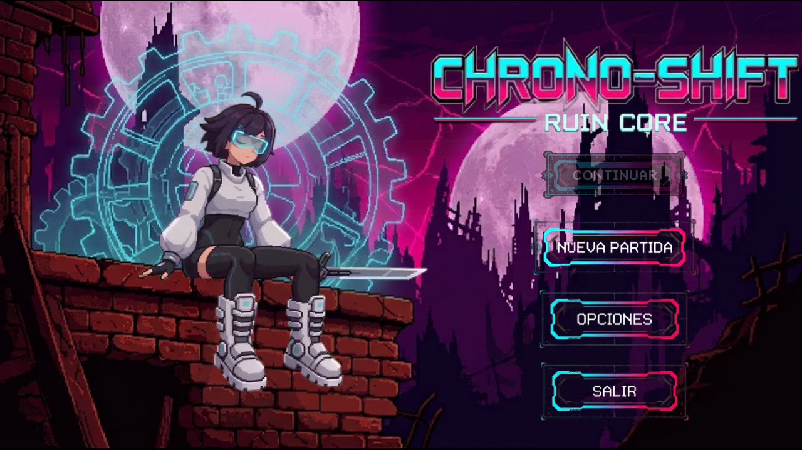
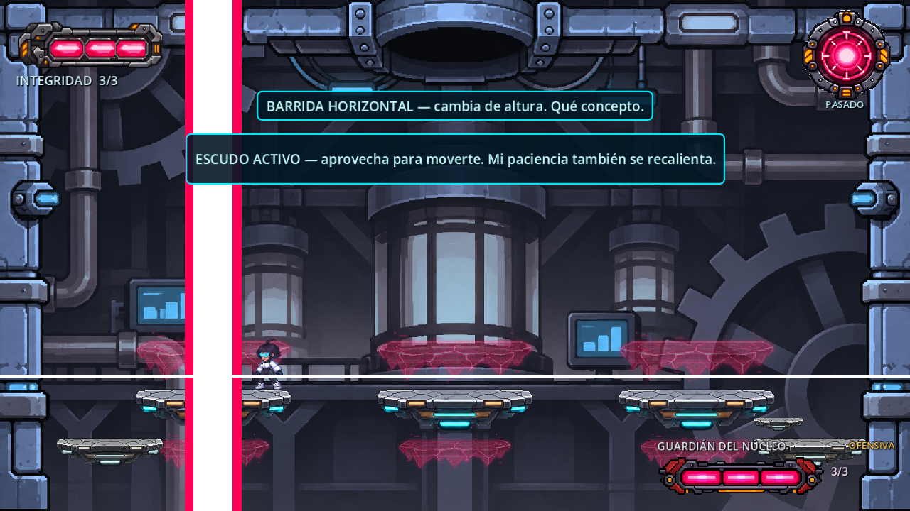
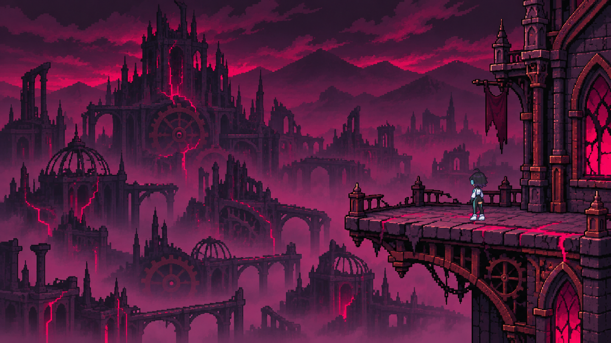

# Chrono-Shift: Ruin Core

*Chrono-Shift: Ruin Core* es un videojuego académico de plataformas 2D y exploración desarrollado con **Godot 4.7.2**. El jugador controla a C.O.R.E.-9 a través de la Torre Zaman y alterna entre el Presente en ruinas y el Pasado intacto para atravesar obstáculos, adquirir habilidades y enfrentarse al Guardián del Núcleo.

## Características

- Cambio instantáneo entre **Presente** y **Pasado**, con geometría y peligros diferentes.
- Movimiento de plataformas 2D, salto y descenso por plataformas atravesables.
- Espada cronal con combate cuerpo a cuerpo.
- Progresión conectada por salas, adquisición de habilidades y Llave del Reactor.
- Enemigos, combate final contra el Guardián del Núcleo y secuencia de cierre.
- Guardado automático por último punto de progreso y opción **Continuar**.

## Controles verificados

Los controles se contrastaron con el mapa de entrada de `project.godot` y los scripts que consumen cada acción.

| Acción | Teclado y ratón | Mando |
|---|---|---|
| Moverse | `A` / `D` o flechas izquierda/derecha | D-Pad izquierda/derecha |
| Agacharse o bajar de plataforma | `S` o flecha abajo | D-Pad abajo |
| Saltar | `Espacio` | Botón inferior (`A` en Xbox) |
| Atacar con la espada | `J` o clic izquierdo | Botón izquierdo (`X` en Xbox) |
| Cambiar de dimensión | `K` o `Shift` izquierdo | Botón de hombro derecho (`RB` en Xbox) |
| Interactuar o avanzar diálogos | `E` | — |

La espada y el cambio dimensional se habilitan al obtener las habilidades correspondientes.

## Ejecutar el proyecto en Godot

1. Instala Godot **4.7.2** para Windows.
2. Clona este repositorio.
3. Importa `project.godot` desde el administrador de proyectos de Godot.
4. Abre el proyecto y pulsa **F6/F5** o el botón de ejecutar proyecto. La escena inicial configurada es `scenes/MainMenu.tscn`.

Los archivos de `.godot/` y `*.import` no se versionan porque Godot los reconstruye al importar el proyecto.

## Descargar y jugar en Windows

1. Abre la sección **Releases** del repositorio.
2. Descarga `Chrono-Shift_Ruin_Core_Windows_x86_64_Release.zip`.
3. Extrae el ZIP completo.
4. Ejecuta `Chrono-Shift_Ruin_Core.exe`.

La distribución es Windows x86_64, lleva el PCK integrado y no requiere instalar Godot, Python ni .NET. El ejecutable no está firmado digitalmente. Los detalles de construcción, validación e integridad están en [docs/WINDOWS_RELEASE.md](docs/WINDOWS_RELEASE.md).

## Capturas

| Combate contra el Guardián | Cierre |
|---|---|
|  |  |

## Organización del repositorio

| Ruta | Contenido |
|---|---|
| `assets/` | Sprites, fondos, animaciones, audio y recursos visuales necesarios |
| `scenes/` | Menú, salas, enemigos, jefe y escena final |
| `scripts/` | Progresión, audio, combate, salas, UI y cierre |
| `shaders/` | Shaders utilizados por el proyecto |
| `tests/` | Validaciones automatizadas del proyecto |
| `tools/` | Herramientas reproducibles de construcción y auditoría |
| `docs/` | Estado, informes técnicos, capturas y documentación UML |
| `GDD.md` | Documento de diseño del videojuego |

Las salidas `build/`, evidencias de diagnóstico, respaldos y perfiles personales se mantienen fuera del historial. El ZIP jugable se distribuye como adjunto de una Release.

## Diagramas UML

Cada diagrama cuenta con PNG, SVG y fuente PlantUML editable en [`docs/diagramas_uml/`](docs/diagramas_uml/):

- [Casos de uso — menú y progreso](docs/diagramas_uml/casos_de_uso_menu_y_progreso.png)
- [Casos de uso — jugabilidad](docs/diagramas_uml/casos_de_uso_jugabilidad.png)
- [Casos de uso — combate y cierre](docs/diagramas_uml/casos_de_uso_combate_y_cierre.png)
- [Diagrama de clases](docs/diagramas_uml/diagrama_clases.png)
- [Secuencia de guardado](docs/diagramas_uml/secuencia_guardado.png)
- [Secuencia de combate](docs/diagramas_uml/secuencia_combate.png)
- [Secuencia del final](docs/diagramas_uml/secuencia_final.png)

## Documentación técnica

- [Estado actual del proyecto](docs/STATE.md)
- [Diseño del juego](GDD.md)
- [Exportación y validación de Windows](docs/WINDOWS_RELEASE.md)
- [Guardado automático por salas](docs/AUTOSAVE_ROOM_CHECKPOINTS.md)
- [Ajuste final del Guardián](docs/GUARDIAN_FINAL_TUNING.md)
- [Sala final](docs/FINAL_ROOM.md)

## Equipo y créditos

**Desarrolladores:**

- Juan Sebastián Ramírez
- Gabriel Muñoz

**Proyecto académico:** *Chrono-Shift: Ruin Core*.

El motor Godot se distribuye bajo licencia MIT; el ZIP de Windows incluye `GODOT_LICENSE.txt` y `THIRD_PARTY_NOTICES.txt`. Los pasos utilizados por el jugador se derivan de [“Footsteps w Clothes Loop” de qubodup](https://freesound.org/people/qubodup/sounds/816018/), basado a su vez en una grabación de jtnewlin13 y publicado bajo CC0.

El proyecto no declara una licencia general de reutilización. La pista musical global y el audio ambiental anterior no se incluyen en el repositorio público porque no se encontró documentación suficiente sobre su autoría o licencia. Permanecen únicamente en la copia local y en el ejecutable local ya construido; no se publicará ese ejecutable hasta aclarar esos derechos o sustituir el audio mediante una decisión autorizada.
